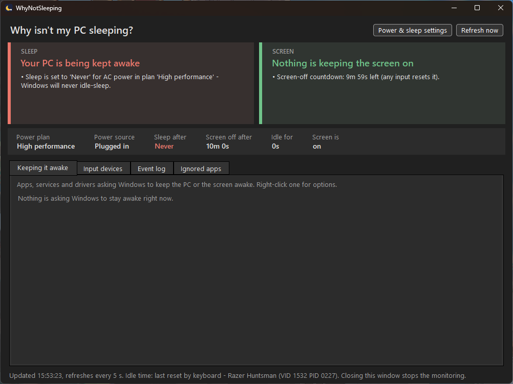
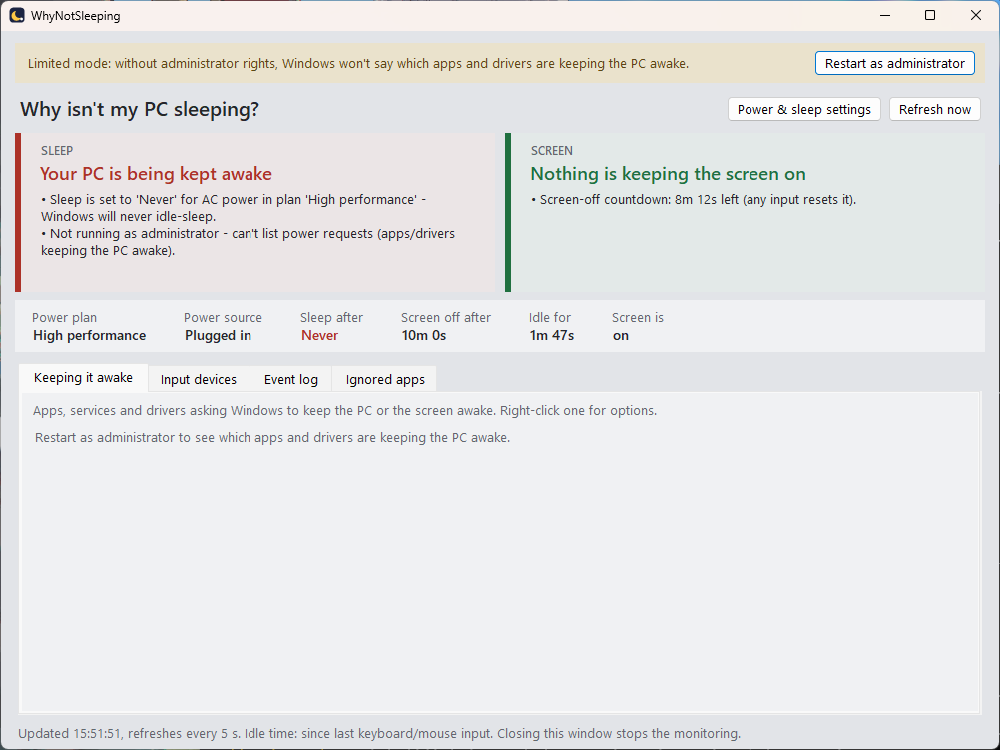
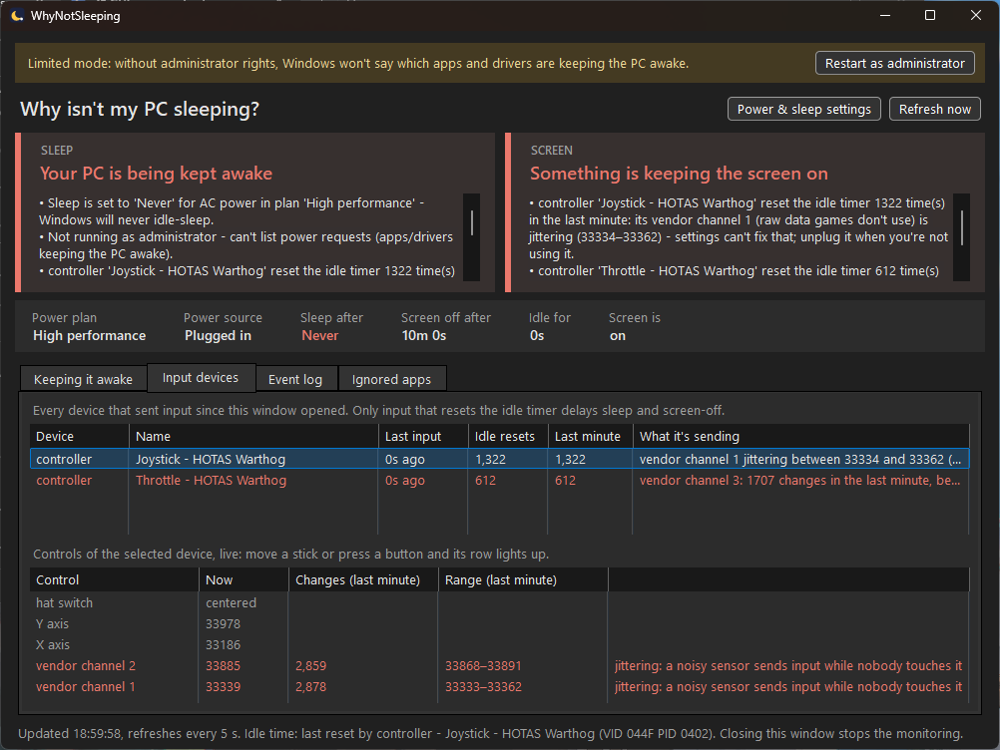

<p align="center"></p>

<h1 align="center">WhyNotSleeping</h1>

<p align="center">Find out what is keeping your Windows PC awake, or your screen on.</p>

<p align="center">
  <a href="https://github.com/peans99/WhyNotSleeping/actions/workflows/ci.yml"></a>
  <a href="https://github.com/peans99/WhyNotSleeping/releases/latest"></a>
  
  
  
  
  
</p>



Your PC is meant to go to sleep after a while, and the screen to turn off, but it doesn't. WhyNotSleeping tells you why: a power plan set to "Never", an app playing audio, a driver holding the system awake, or a device (a mouse, a joystick, a remote) sending input that Windows counts as you being there.

## Download

Grab **WhyNotSleeping.exe** from the [latest release](https://github.com/peans99/WhyNotSleeping/releases/latest) and double-click it. There's nothing to install or unpack, and you don't need .NET.

- It asks for **administrator rights** (the UAC prompt). Only an administrator can see *which* apps and drivers are keeping Windows awake. If you say no, it still runs and shows your power settings, the screen state and your input devices.
- Windows may say the publisher is unknown because the executable is not code signed. Choose **More info**, then **Run anyway**.
- It follows your Windows light/dark setting.
- Closing the window doesn't stop it: it keeps watching from the notification area (the tray). Click its icon to bring the window back, right-click it and choose **Exit** to quit. Tick **Start with Windows** to have it start there each time you sign in, without the administrator prompt (it's a scheduled task named *WhyNotSleeping*).

**WhyNotSleepingCli.exe** is the same monitor in a console window, for anyone who'd rather have that (see [Console version](#console-version)).

## What it shows

Two verdicts at the top, **Sleep** and **Screen**, each saying in plain words whether something is blocking it and what. Below them:

- **Your power plan**: when the PC sleeps and the screen turns off ("Never" is the most common culprit), whether you're plugged in, how long you've been idle, and whether the screen is actually on, off or dimmed.
- **Keeping it awake**: the apps, services and drivers asking Windows to stay awake (audio streams, video playback, downloads, Windows Update...) and how long each has been holding on. Right-click an app to ignore its requests or open its folder.
- **Input devices**: every mouse, keyboard, game controller, touchpad, touch screen, pen, media-key remote and power button that sent input, by name (e.g. "Razer Basilisk V3"), which ones actually reset the idle timer, and what each one is sending ("key Num Enter", "mouse moved", "vendor channel 2 jittering between 33856 and 33879"). Click a controller to watch its axes and buttons live. Jittery controls and software-injected input (remote desktop, mouse jigglers) are flagged.
- **Event log**: requests appearing and disappearing, power changes, the screen turning off and on (and how late that was compared to the timeout), input after a quiet spell, and gaps where the PC was actually asleep. It's also saved to `%LOCALAPPDATA%\WhyNotSleeping\whynotsleeping.log`, so you can leave it running overnight and check in the morning what woke the screen at 3am.
- **When I'm away**: the away group, controllers to turn off by themselves while you're away (see [below](#turn-it-off-only-while-youre-away)).
- **Ignored apps**: apps whose requests Windows has been told to disregard, with a button to stop ignoring them.

<details>
<summary>Light mode</summary>



</details>

## Fixing common causes

| What you see | What to do |
|---|---|
| Sleep after: **Never** | Click **Power & sleep settings** and pick a time under *Screen, sleep & hibernate timeouts*. |
| Screen off after: **Never** | Same place, the screen timeout. |
| An app is *Keeping the screen on* | Usually a video player or a browser tab playing video. Close or pause it. |
| An app is *Keeping the PC awake* | Often audio (a muted or forgotten stream, a voice chat app). Close it, or right-click it and choose **Ignore this app** if you never want it to keep the PC awake. |
| A driver says *An audio stream is currently in use* | Something is playing sound, even silence. Find the app playing audio and close it. |
| A **controller, joystick or HOTAS** is resetting the idle timer | See below. |

### A controller, joystick or HOTAS keeps the screen on

Some controllers reset Windows' idle timer every time they send a report, and a controller with a noisy sensor sends reports all the time, even when nobody touches it. To find out which part is doing it, open **Input devices**, click the controller and leave it alone for a minute. The list below shows every axis and button live. Whatever you move or press lights up, and a control that changes on its own is marked in red: **jittering** when it wanders over a sliver of its range, or **changing nonstop** when it keeps moving for a whole minute while the keyboard and mouse sit idle.



That screenshot is a real Thrustmaster HOTAS Warthog that nobody was touching. Its X and Y axes don't move, but it also reports two **vendor channels**, a raw copy of the stick's position that games don't read, and those wander by a few counts thousands of times a minute. That alone reset the idle timer over 1,300 times a minute.

- **A jittering axis** (X, Y, throttle, slider...): recalibrate it, or add a small deadzone in the vendor's software (VKB DevCfg, VPC Configurator, Thrustmaster TARGET, Logitech G HUB...).
- **A jittering vendor channel:** no game setting, deadzone or calibration reaches it. Turn the device off when you're not using it: right-click it in **Input devices** and choose **Turn off this device** (it stays off, even after a restart, until you right-click it and choose **Turn back on**). Or unplug it; a USB hub with power switches makes that easy.

If Windows refuses to turn a device off because a program has it open, WhyNotSleeping names that program. It is often **Steam** (Steam Input keeps every controller open): exit Steam, turn the device off, then start Steam again.
- **Keyboard or mouse modes:** many HOTAS and button boxes also show up as a keyboard or mouse, or their software (TARGET, Joystick Gremlin, Steam Input) turns axes and buttons into key presses. Look in **Input devices** for a keyboard or mouse with your stick's name: the *What it's sending* column says which key or movement it is.

The verdict cards name the device and the control, so you can check a fix worked.

#### Turn it off only while you're away

Turning a stick off by hand every evening gets old. Put it in the **away group** instead: right-click it in **Input devices** and choose **Add to the away group**. Then, once nobody has used the keyboard or mouse for 10 minutes (you choose how long, in the **When I'm away** tab) and all the stick sends is noise, WhyNotSleeping turns it off and, as you choose:

- lets Windows turn the screen off and sleep on its usual schedule, now that nothing resets the idle timer,
- turns the screen off right away (the default), or
- puts the PC to sleep right away.

It comes back on as soon as you move the mouse, press a key, use a controller or unlock the PC. Pressing buttons or really moving the sticks of **any** controller counts as someone being there, so nothing is turned off under someone flying with the HOTAS alone or playing with a gamepad; noise from vendor channels or a tiny jitter doesn't count. (A controller whose axis keeps swinging widely on its own looks like someone using it, and keeps the group on: the **When I'm away** tab names it. Recalibrate it, or turn it off when you're not using it.) By default it also waits while a full-screen game, video or presentation is running. The event log says when it turned the devices off and back on.

The away group turns devices off only until they're turned back on or Windows restarts, so nothing can stay off for good: if WhyNotSleeping is stopped while they're off, it turns them back on the next time it starts. It needs administrator rights, and **Steam** can stop it like it stops **Turn off this device** (see above); it then says so in a notification and in the event log.

## Console version

```text
WhyNotSleepingCli [options]
  -i, --interval <sec>  Refresh interval (default 5)
      --once            Print a single snapshot and exit
      --log <file>      Event log file (default .\whynotsleeping.log)
      --no-log          Don't write an event log
      --no-elevate      Don't relaunch as administrator (power requests won't be visible)

Keys: [q]/[Esc] quit, [r] refresh now.
```

Useful command-line equivalents of the fixes above (run as administrator):

```powershell
powercfg /change standby-timeout-ac 30                    # sleep after 30 minutes on AC
powercfg /change monitor-timeout-ac 10                    # screen off after 10 minutes on AC
powercfg /requestsoverride PROCESS app.exe SYSTEM DISPLAY  # ignore an app's requests
powercfg /requestsoverride PROCESS app.exe                 # stop ignoring it
```

## Building

Needs the [.NET 10 SDK](https://dotnet.microsoft.com/download) on Windows.

```powershell
dotnet run --project src/WhyNotSleeping.Gui     # the window
dotnet run --project src/WhyNotSleeping.Cli     # the console monitor
dotnet test                                     # the tests
./build.ps1                                     # both single-file executables into dist\
./scan.ps1                                      # scan dist\ with Microsoft Defender, as CI does
```

The solution has three projects. `WhyNotSleeping.Core` holds the monitoring: power settings, `powercfg` requests and overrides, display-state notifications, raw input, the verdicts and the away group. `WhyNotSleeping.Gui` (WinForms) and `WhyNotSleeping.Cli` are two front ends over it.

`tests/WhyNotSleeping.Tests` (xunit) checks what decides things, without the machine it usually reads: parsing `powercfg` output, the two verdicts, what counts as noise from a controller and what as someone using it, when the away group acts and every reason it waits, and what is written to disk (the settings file and the startup task).

CI builds with warnings as errors, runs the tests, publishes both executables exactly as a release does, smoke-tests the console tool, and scans the executables with Microsoft Defender. The release workflow runs the tests and the same scan again before it publishes anything. Dependabot keeps the Actions and the test packages current, monthly.

### Releasing

1. Bump `<Version>` in `Directory.Build.props` and add a `### <version>` section under [Release notes](#release-notes). CI fails a pull request that changes `src/` without both, unless a commit says why it doesn't need to with a `No-version-bump: <reason>` trailer.
2. Open a pull request. The `main` branch ruleset (`.github/rulesets/main.json`) requires both CI checks to pass before it merges, and blocks force-pushes and deletion; repository admins can bypass it.
3. Merge, then tag the merge commit: `git tag -a v1.0.1 -m "..." && git push origin v1.0.1`.

The release workflow refuses a tag that disagrees with `Directory.Build.props`. It builds both executables, smoke-tests the console tool, scans the files with Microsoft Defender, and publishes them with that version's notes.

## Release notes

### 1.1.0

- Runs in the notification area: closing the window keeps it watching. Click the icon to open it, right-click it to exit.
- **Start with Windows**, in the tray, without the administrator prompt at each sign-in.
- **The away group**: controllers that are turned off by themselves after a while with nobody at the keyboard, mouse or a controller, if all they send is noise, then the screen turned off or the PC put to sleep if you like. Playing with any controller keeps them on; they come back on with the mouse, a key, a controller or unlocking the PC.
- A noisy controller in the away group shows in the verdicts as a warning that says it is taken care of, not as a red problem.
- Starting it a second time brings the running window forward.
- A device turned off and on again, or replugged, is listed once, keeping its history.

### 1.0.2

- Works on Windows in other languages: whether it runs as administrator is checked directly, instead of by looking for `powercfg`'s English refusal. On Windows in another language the refusal is translated, and could have been taken for "nothing is keeping it awake".
- A control that keeps changing for a whole minute while the keyboard and mouse sit idle is flagged as changing on its own, even when it swings over a wide range. Before, only small jitter was caught. The verdicts name that control first.
- The ignored apps list no longer asks for administrator rights; Windows shows it to anyone.
- Turning a device off and back on is now tested on real hardware (a Thrustmaster rudder, once Steam had let go of it).

### 1.0.1

- Turn an input device off and back on from **Input devices** (right-click), like Disable in Device Manager: for a controller whose noisy sensor keeps the screen on, without unplugging it. It stays off until you turn it back on, and the app lists it as turned off even after a restart. Mice and keyboards can't be turned off this way, so you can't lock yourself out.
- When a program has the device open and Windows won't turn it off, the message names the program (often Steam).

### 1.0.0

- First release: a window (`WhyNotSleeping.exe`) and a console monitor (`WhyNotSleepingCli.exe`), both single self-contained executables.
- Verdicts for sleep and the screen: power plan timeouts, power requests, display state, and input devices that reset the idle timer.
- Says what each input device is sending, and shows a controller's axes and buttons live, so a jittering axis or channel can be pinned down to the exact control.
- Ignore an app's power requests from the window, and stop ignoring it again.
- Follows the Windows light/dark setting.

## License

[Apache License 2.0](LICENSE)
